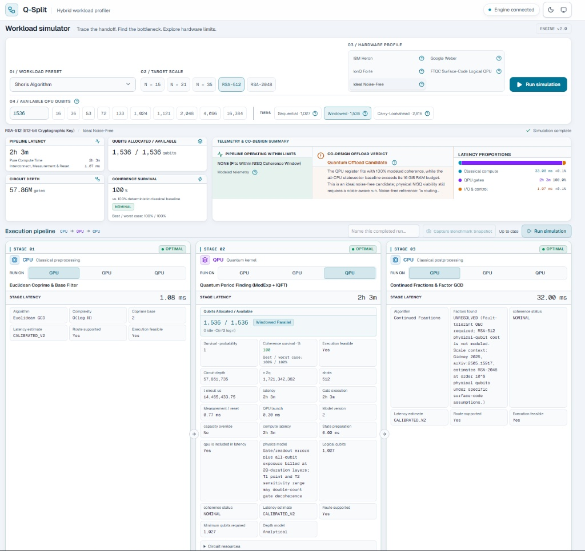

# ⚡ Q-Split

**A hybrid quantum-classical workload simulator: see where quantum offload helps, and where it falls apart.**

Q-Split helps you decide which parts of a program to send to a quantum processor and which to keep on CPUs or GPUs. Choose a workload, route its three stages, and compare modeled runtime, hardware capacity, and the chance that a quantum calculation finishes without errors. It shows when data transfers, limited memory, or quantum noise outweigh the benefit of offloading work. Small circuits run in a simulator; larger cases use documented estimates so you can explore the tradeoffs without access to quantum hardware.

[**Live demo**](https://q-split.vercel.app/) · [Run it locally](#quickstart) · [Documentation](#documentation)

> ⏳ **First load note:** the simulation engine runs on a free-tier host that sleeps when idle. If the first simulation takes 30–60 seconds, it's just waking up. After that it's fast.



## What is this?

A run follows classical preprocessing → quantum kernel → classical postprocessing. Compare the placement choices through latency, coherence, bottlenecks, and an offload verdict.

## Try it in 60 seconds

1. Open the [live demo](https://q-split.vercel.app/).
2. Choose **Shor's Algorithm**, **N = 15**, **IBM Heron**, then click **Run simulation**.
3. Switch to a larger scale such as **RSA-2048** and run again. Compare how the bottleneck, coherence and verdict change.
4. Reassign a pipeline stage to **CPU / GPU / QPU** and re-run to see how routing changes the result.
5. Click **Generate analysis** to get an AI-written architecture diagnosis of your run.

## Features

- **Two workloads:** Shor's Algorithm (N = 15 up to RSA-2048) and Quantum-MIPS vector retrieval (M = 64 up to 1M).
- **Eight built-in profiles plus custom research hardware:** IBM Heron, IBM Nighthawk r2, Nighthawk r3 single and linked dual roadmap systems, Google Weber, IonQ Forte, a fault-tolerant surface-code logical QPU, and an ideal noise-free reference.
- **Dual simulation engine:** small reference circuits run in Qiskit Aer, and larger scales use analytical co-design models.
- **Per-stage routing:** assign each pipeline stage to CPU, GPU or QPU.
- **Telemetry:** latency breakdown, circuit depth, coherence survival and bottleneck detection.
- **Run history:** save, pin and name snapshots, compare up to three runs, and export to CSV or JSON.
- **AI Telemetry Advisor:** Gemini-powered diagnostics with database caching and a deterministic fallback when the AI is unavailable.
- **Custom inverse design:** locally verified 50%/80% survival targets, isolated subsystem ceilings, and minimum-distance surface-code alternatives with one-click application ([model details](docs/inverse-design.md)).
- **Tested:** a 2,025-configuration backend integration matrix plus unit tests.

## Tech stack

| Layer | Tools |
|---|---|
| Frontend | Next.js 16, React 19, TypeScript, Tailwind CSS |
| API & persistence | Next.js route handlers, Prisma, Neon serverless PostgreSQL |
| Simulation engine | Python, FastAPI, Pydantic, Qiskit Aer (Dockerized) |
| AI | Google Gemini with grounded prompts and read-through caching |
| Hosting | Vercel (frontend), Render (engine) |

## Architecture

- Browser requests use same-origin Next.js API routes.
- The containerized Python engine combines Qiskit Aer reference circuits with an analytical hardware profiler.
- Aer references and analytical projections are separate simulation modes; see [methodology](docs/methodology.md) for the model contract and diagnostics.

## Workloads and hardware profiles

* Shor's Algorithm (N = 15, 21, 35, RSA-512, RSA-2048): The public API accepts these five presets, matching the frontend; other Shor scales return HTTP 422. Models factoring pipelines, with CPU preferred for scalar host stages in this calibration. RSA-scale runs project resource requirements; they do not factor real RSA keys. The QPU model accounts for modular-exponentiation depth and coherence limits.
* Quantum-MIPS (Maximum Inner Product Search; LLM Vector Retrieval) (M = 64, 1,024, 32k, 128k, 1M): Models LSH pruning and FP16 reranking, with GPU hosts preferred at M >= 1,024. Grover's search / amplitude amplification uses O(√M) iterations in the reference model. This is not a measured end-to-end vector retrieval speedup.

### Hardware Profiles

* **IBM Heron:** Representative 133-qubit cap with r3-era timing and Heavy-Hex superconducting connectivity ([sources, assumptions and caveats](docs/hardware-profiles.md#ibm-heron)).
* **IBM Quantum System Two (Nighthawk r2):** 120 programmable transmons on a four-degree grid; 40 ns 2Q, 1 µs reset and a conservative 100 kHz peak-rate model ([values, provenance and throughput interpretation](docs/hardware-profiles.md#ibm-nighthawk-r2)).
* **IBM Quantum System Two (Nighthawk r3 — 520Q):** 520 programmable / 2,034 physical qubits, one module and ten installed, idle l-couplers; r2 physics inherited as assumptions ([2027 roadmap profiles](docs/hardware-profiles.md#ibm-nighthawk-r3-and-linked-dual-system)).
* **IBM Quantum System Two (2x Nighthawk r3 Linked — 1,040Q):** Two 520-qubit modules and ten active bridge channels; configurable placement, transfer fidelity and assumed round duration ([model and provenance](docs/hardware-profiles.md#ibm-nighthawk-r3-and-linked-dual-system)).
* **Google Weber:** Representative 53-qubit 2D square-grid profile ([sources, assumptions and caveats](docs/hardware-profiles.md#google-weber)). CALIBRATED_V2 uses the 53-qubit datasheet reference; larger capacity presets are exploratory overrides.
* **IonQ Forte:** Representative 36-qubit all-to-all trapped-ion profile ([sources, assumptions and caveats](docs/hardware-profiles.md#ionq-forte)).
* **FTQC Surface-Code:** Representative logical QPU with 1,024 logical workspace qubits and a d≈27 target ([sources, assumptions and caveats](docs/hardware-profiles.md#ftqc-surface-code)).
* **Ideal Noise-Free:** Theoretical reference with unlimited stored profile capacity and no modeled noise; explicit UI capacity limits still apply ([assumptions and caveats](docs/hardware-profiles.md#ideal-noise-free)).

Custom / Research hardware adds a parameter builder with all eight clone baselines, scientific-notation inputs, logical-mode idle-decay control, and named browser-local presets. Logical mode also offers a [surface-code distance calculator](docs/hardware-profiles.md#surface-code-distance-calculator) with physical footprint and reference-calibrated operation errors. Custom configurations use the same estimator and remain attached to saved runs, advisor diagnostics, comparisons and exports. See [custom hardware contracts and limits](docs/hardware-profiles.md#custom--research-hardware).

## Quickstart

1. Clone the repository and install the frontend dependencies:

   ```sh
   git clone https://github.com/Mic-Sp/Q-split.git q-split
   cd q-split/frontend
   npm install
   cp .env.example .env.local
   ```

2. Edit `frontend/.env.local`. The engine URL is a server-side runtime setting; database and Gemini credentials are optional:

   ```dotenv
   SIMULATION_API_URL=http://localhost:8000
   ENGINE_SECRET=
   DATABASE_URL=
   DATABASE_URL_UNPOOLED=
   GEMINI_API_KEY=
   ```

3. In a separate terminal, create the Python environment and start the backend **from the repository root**:

   ```sh
   python3 -m venv backend/venv
   backend/venv/bin/python -m pip install -r backend/requirements.txt
   backend/venv/bin/python -m uvicorn backend.main:app --reload --port 8000
   ```

4. Start the frontend **from `frontend/`**:

   ```sh
   npm run dev
   ```

   Open http://localhost:3000.

5. Run the test suites:

   From the repository root:

   ```sh
   backend/venv/bin/python -m pip install -r backend/requirements-dev.txt
   backend/venv/bin/python -m pytest backend/tests -q
   ```

   From `frontend/`:

   ```sh
   npx tsc --noEmit
   npm test  # Existing regression suite plus custom-profile Vitest tests
   ```

   The frontend tests include the 2,025-configuration backend integration matrix and use the Python environment installed above.

If `ENGINE_SECRET` is set, use the same value on both servers. See [deployment](docs/deployment.md) for credentials, production setup, and the health probe; see [persistence](docs/persistence.md) for optional database setup.

## Documentation

| Guide | Contents |
| --- | --- |
| [Hardware profiles](docs/hardware-profiles.md) | Profile parameters, sources, assumptions, and capacity overrides. |
| [Methodology](docs/methodology.md) | Verdicts, timing and survival formulas, FTQC examples, and calibration. |
| [Advisor](docs/advisor.md) | AI diagnostics, caching, rate limits, and input validation. |
| [Deployment](docs/deployment.md) | Engine credentials, health probes, cold starts, production, and Docker. |
| [Persistence](docs/persistence.md) | Saved runs, session isolation, database setup, and TTL maintenance. |

## What this is (and isn't)

Q-Split is an **educational simulator**. Results are modeled estimates built on simplified, comparative assumptions. They are **not** physical-device benchmarks, there is no connection to real quantum hardware, and RSA-scale runs project resource requirements rather than factoring real keys. Nothing here is evidence of practical quantum advantage.

Licensed under the [MIT License](LICENSE).
